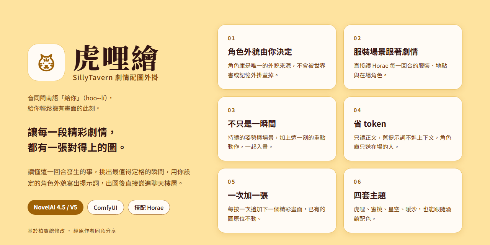

# 虎哩繪 · SillyTavern 劇情配圖外掛

> **虎哩繪，音同閩南語「給你」（hōo--lí），給你輕鬆擁有畫面的此刻。**
>
> 讓 AI 寫出的每一段精彩劇情，都有一張對得上的圖。
> 虎哩繪會讀懂這一回合發生了什麼，挑出最值得定格的瞬間，用你設定好的角色外貌寫出生圖提示詞，交給 NovelAI 或 ComfyUI 出圖，直接嵌進聊天樓層裡。

本專案基於 [柏寶繪 ST-BaiBai-Image](https://github.com/baibai-git/ST-BaiBai-Image)（作者：柏柏）修改而來，經原作者同意分享，並針對 [Horae](https://github.com/Minijinai75/SillyTavern-Horae-1) 記憶外掛重新設計了資料來源。感謝原作者打下的基礎。

---

## 為什麼用虎哩繪

### 🎯 角色外貌由你決定，不會被亂改
- **角色固定外貌庫是唯一的外貌來源**：你在角色管理裡寫好的髮色、瞳色、體型，每一張圖都會照抄，不會被世界書、角色卡或記憶外掛的描述蓋掉。
- **只在需要時才補資料**：還沒建檔的新角色，才會參考 Horae 的外貌描述自動建檔；建檔只收「畫得出來、永久不變」的特徵，身高數字、性格、黑眼圈這類暫時狀態不會汙染你的角色庫。
- **全域角色**：玩家角色這類每個聊天都同一張臉的角色，可以提升為全域，所有聊天共用，AI 永遠不會修改。

### 👗 服裝、場景跟著劇情走
- **服裝直接讀 Horae 這一回合的記錄**：襯衫凌亂、外套滑落、褲子退到大腿……每一件衣物和它的狀態都會逐件轉成 tag，沒寫的衣物不會自己腦補。
- **場景只讀「這一樓」**：地點、氛圍、場景特徵、時刻都取自 Horae 單樓的記錄，不會把整份記憶（物品、NPC、待辦、劇情軌跡）塞進提示詞。
- **世界背景一行搞定**：在角色管理填一行「18世紀歐洲・洛可可宮廷」或「現代韓國首爾」，服裝、建築、道具就會自動套用那個時代的樣式，不必每次都讀世界書。也可以一鍵從 Horae 匯入。

### 🎬 畫面不只是「一瞬間」
- **持續狀態 ＋ 重點動作**：兩人原本躺在草地上聊天，接著接吻——畫出來的會是「躺在草地上接吻」，而不是憑空站著接吻。
- **景別會配合動作**：躺臥、交疊、跨坐、大動作會自動用全身或遠景配橫圖，臉部特寫只留給以表情為主的畫面。
- **雙人互動精準配對**：自動使用 NovelAI 4.5 / V5 的 `source#` / `target#` / `mutual#` 互動前綴，誰對誰做了什麼不會畫錯。

### 💰 省 token
- **只讀 `<content>` 裡的正文**：Horae、MVU、選項按鈕、狀態列等外掛標籤一律略過，換角色卡也不必再加清洗規則。
- **舊的生圖提示詞不進上下文**：歷史樓層的生圖標籤會從主對話的上下文隱藏，也不會再送給生圖模型。
- **角色庫只送在場的人**：角色庫有十個人、這一幕只有兩個在場，就只送那兩個人的完整外貌。
- **跟隨主 API 也乾淨**：使用主 API 時會自動排除 Horae 的整份記憶注入，只送虎哩繪自己準備好的資料。

### 🖱️ 操作直覺
- **自動配圖**：AI 回覆後自動判斷值不值得畫，張數上限可自訂。
- **一次加一張**：樓層選單的調色盤按鈕每按一次追加一張——第一次是最精彩的畫面，再按是第二精彩的，已有的圖片原位不動。
- **單張重寫**：對某張不滿意，在卡片的提示詞編輯裡可以自己改，或讓 AI 只重寫這一張，同樓其他圖片不受影響。
- **只花該花的錢**：對已有提示詞的圖片重新出圖，只消耗 NovelAI 點數，不消耗語言模型的 token。

### 🎨 出圖渠道
- **NovelAI**：支援 4.5 與 V5。4.5 送出純 tag；V5 額外送出場景的自然語言描述。支援畫師串、vibe 參考圖、多個接入點切換。
- **ComfyUI**：簡易參數模式或自訂工作流，可存多套工作流隨時切換。提示詞寫法會依模型類型自動調整：Checkpoint（SD1.5／SDXL／Illustrious）送排好順序的 tag，Flux 以自然語言為主，Anima 兩者一起送。
- **副 API 渠道**：可以指派專門的模型渠道寫提示詞，不占用主對話；不設定就跟隨主 API。

### 🐯 介面
- 四套主題：**虎哩**、**蜜桃**、**星空**（深色）、**暖沙**，另可選擇跟隨 SillyTavern 配色。
- 手機、平板、電腦都能用；內建相簿與請求紀錄，可查看每次送出的提示詞與 token 用量。

---

## 安裝

1. 在 SillyTavern 的「擴充功能 → 安裝擴充功能」填入本倉庫網址：
   ```
   https://github.com/wowdog0987/ST-hooli-Image
   ```
2. 打開虎哩繪面板，到「渠道」頁設定出圖方式（見下方「出圖渠道設定」）。
3. 到「角色管理」**手動建立主要角色的外貌**（或用「從Horae生成」後檢查一遍），並填寫一行世界背景。角色名要和正文、Horae 記錄的寫法一模一樣。
4. 確認「設定」頁的「自動生成 tag」已開啟，就可以開始聊天了。

設定會存在 SillyTavern 伺服器上，換裝置也會同步。

### 出圖渠道設定

**NovelAI**
1. 到 NovelAI 官網登入 → 左下角齒輪「User Settings」→「Account」→「Get Persistent API Token」，複製 Token。
2. 虎哩繪「渠道」頁 → NovelAI →「配置」，在 API Key 貼上 Token，按「測試連線」，再按「使用此渠道出圖」。
3. 選模型（4.5 或 V5）。

**ComfyUI**
1. 先啟動 ComfyUI，確認瀏覽器打得開 `http://127.0.0.1:8188`。
2. 虎哩繪「渠道」頁 → ComfyUI →「配置」，URL 填 ComfyUI 網址，按「測試連線」，再按「使用此渠道出圖」。
3. 「配置方式」選「**簡易引數**」→ 選模板（一般二次元模型選 Checkpoint）→「拉取模型列表」→ 選模型。
4. 想用自己的工作流：ComfyUI 選單 Workflow › Export (API) 匯出，貼到「自定義工作流」。

**寫提示詞的模型**
- 不設定的話會跟隨酒館主介面的 API。想用別的模型，在「渠道」頁新增副 API 渠道，再到「設定」頁把「生成畫圖 tag」指派給它。

## 建議搭配

- **[Horae](https://github.com/Minijinai75/SillyTavern-Horae-1)**：提供每一回合的服裝、場景與在場角色。虎哩繪直接讀取 Horae 存在聊天紀錄裡的資料，裝標準版 Horae 即可，不需要額外設定。沒有 Horae 也能運作，但服裝與場景會改由 AI 從正文推斷，準確度較低。
- **以 `<content>…</content>` 包住正文的角色卡或預設**：虎哩繪會只讀這一段，其他外掛標籤完全不影響配圖。沒有 `<content>` 的格式也能用，會自動改用一般清洗方式。

## 與原版柏寶繪的主要差異

| | 柏寶繪 | 虎哩繪 |
|---|---|---|
| 記憶來源 | 柏寶書 | Horae（只讀單樓結果） |
| 角色外貌 | 角色庫、世界書、角色卡、記憶外掛綜合判斷 | 以角色庫為準，新角色才參考 Horae |
| 世界觀 | 讀取世界書 | 一行世界背景設定 |
| 正文讀取 | 黑名單清洗 | 優先只讀 `<content>` |
| 樓層按鈕 | 整樓重新生成 | 每按一次追加一張 |
| 自動更新 | 內建 | 已移除（避免覆蓋自訂修改） |

## 更新紀錄

### 1.1.0（2026-10-24）
- **ComfyUI 提示詞依模型類型自動調整**：Checkpoint（SD1.5／SDXL／Illustrious）送排好順序的 tag，角色外貌排在最前面，不再被場景擠到後段；Flux 以自然語言為主、附上 tag；Anima 兩者一起送。選模板時「生成自然語言」會自動設好。
- **ComfyUI 多人畫面更穩**：人數 tag 放最前面，每個角色的 tag 集中成一組，男女同框會補上 `hetero`。
- **ComfyUI 權重寫法自動轉換**：角色庫裡 NovelAI 寫法的權重，送 Checkpoint 時轉成 `(tag:1.3)`，送 Flux／Anima 時拿掉。
- **自訂工作流可選「模型類型」**，提示詞寫法跟著它走。
- **新手設定步驟**：NovelAI 與 ComfyUI 渠道頁加上「第一次使用？照這幾步設定」，新裝的 ComfyUI 預設用簡易參數模式，不再出現「請填寫工作流」。
- **跟隨主 API 更相容**：遇到模型拒絕請求（Bad Request）時會自動降級重試，不必手動調整。
- **NovelAI 4.5／V5 分開處理**：4.5 只送 tag，V5 額外送場景描述；服裝改用常見 danbooru tag，避免「騎馬裝」被畫成修女服這類誤會；權重少打一個冒號也會自動修正。
- **相簿**：看大圖時可以直接刪除、左右滑動切換，刪完自動顯示下一張。

### 1.0.0（2026-10-22）
- 第一個公開版本：改造為搭配 Horae 記憶外掛的劇情配圖外掛。

## 給外掛作者

虎哩繪保留了原版的公開介面（`globalThis.STBaiBaiImage`），其他外掛可以讀取角色庫，或借用虎哩繪的出圖渠道生成圖片。詳見 [PUBLIC_API.md](./PUBLIC_API.md)。

## 致謝

- 原作 [柏寶繪 ST-BaiBai-Image](https://github.com/baibai-git/ST-BaiBai-Image) — 柏柏
- 記憶外掛 [Horae](https://github.com/Minijinai75/SillyTavern-Horae-1) — SenriYuki、Minijinai75、chiao
